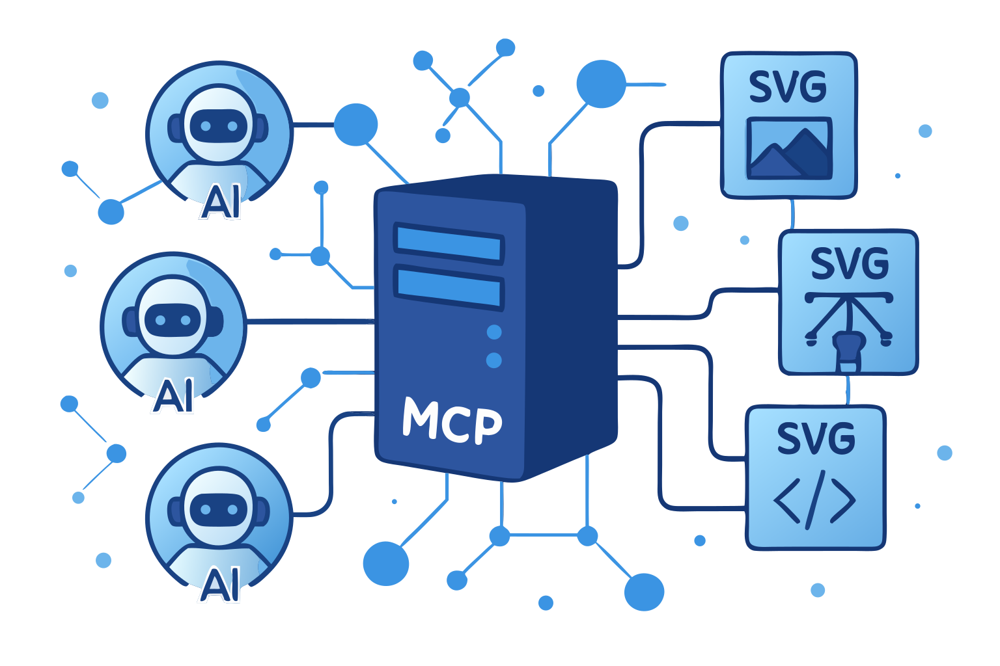

# SVGMaker MCP Server
A powerful MCP server for generating, editing, and converting SVG images using SVGMaker API.

[](https://svgmaker.io)
[](https://www.npmjs.com/package/@genwave/svgmaker-mcp)
[](https://github.com/GenWaveLLC/svgmaker-mcp/blob/main/LICENSE)
[](https://github.com/GenWaveLLC/svgmaker-mcp/actions)
[](https://www.npmjs.com/package/@genwave/svgmaker-mcp)

## 🎨 MCP Server in Action



*This very illustration came to life through our own SVGMaker MCP server—a living example of AI assistants and vector graphics working in perfect harmony via the Model Context Protocol.*

## 🌟 Highlights

- **🎨 AI-Powered SVG Generation**: Create SVGs from text descriptions
- **✏️ Smart SVG Editing**: Edit existing SVGs with natural language
- **🖼️ Raster Mode**: Skip vectorization and get a quick PNG instead of SVG
- **🔄 Image-to-SVG Conversion**: Convert any image to scalable SVG
- **🪄 Background Removal**: Isolate the foreground subject and get a clean SVG with transparency
- **👁️ Inline Image Preview**: Preview generations and gallery items directly in chat
- **🔒 Secure File Operations**: Built-in path validation and security
- **⚡ Real-Time Progress**: Live updates during operations
- **📝 Type Safety**: Full TypeScript support with type definitions

## 📋 Table of Contents

- [Requirements](#-requirements)
- [Installation](#-installation)
- [Quick Start](#-quick-start)
- [LLM Integrations](#-llm-integrations)
- [Available Tools](#️-available-tools)
- [Configuration](#️-configuration)
- [Development](#-development)
- [Contributing](#-contributing)

## 💻 Requirements

- Node.js: Minimum version 20.9.0
  ```bash
  node --version  # Should be >= v20.9.0
  ```
- npm: Minimum version 7.0.0
  ```bash
  npm --version   # Should be >= 7.0.0
  ```
- Operating Systems: 
  - Linux (Ubuntu 20.04+, CentOS 8+)
  - macOS (10.15+)
  - Windows (10+)
- SVGMaker API key ([Get one here](https://svgmaker.io/account))

## 📦 Package Structure

```
@genwave/svgmaker-mcp/
├── build/             # Compiled JavaScript files
├── docs/              # Documentation
│   └── api/           # API documentation
├── src/               # Source TypeScript files
│   ├── tools/         # MCP tool implementations
│   ├── services/      # API integration
│   └── utils/         # Utility functions
└── types/             # TypeScript declarations
```

## 🚀 Installation

```bash
# Using npm
npm install @genwave/svgmaker-mcp

# Using yarn
yarn add @genwave/svgmaker-mcp
```

### Basic Setup

1. Create .env file:
```bash
SVGMAKER_API_KEY="your_api_key_here"
```

2. Start the server:
```bash
npx svgmaker-mcp
```

## 🔌 LLM Integrations

Every client below can run the server two ways:

- **stdio** — the server runs on your machine with your API key. Local file paths work, and `output_path` saves the result to disk.
- **HTTPS** — the server runs in the cloud at `https://mcp.svgmaker.io/mcp` and you sign in through the browser. The cloud server cannot see your disk, so `output_path` is not offered and results come back as hosted SVGMaker URLs. Local files must go through [`svgmaker_upload`](#svgmaker_upload) first.

The example prompts in each section are given in both shapes. Use the one that matches your setup.

### 🔌 Claude Desktop

1. Add to `claude_desktop_config.json`.

   **stdio (API key):**

   ```json
   {
     "mcpServers": {
       "svgmaker": {
         "command": "npx",
         "args": ["@genwave/svgmaker-mcp"],
         "transport": "stdio",
         "env": {
           "SVGMAKER_API_KEY": "your_api_key_here"
         }
       }
     }
   }
   ```

   **HTTPS (OAuth browser login — no API key):**

   Claude Desktop connects to remote servers from the UI, not from the config file: **Settings → Connectors → Add custom connector**, then enter `https://mcp.svgmaker.io/mcp` and complete the browser login.

2. Example usage in Claude Desktop:

   **stdio (API key):**

   ```
   Generate an SVG of a minimalist mountain landscape:
   <mcp>
   {
     "server": "svgmaker",
     "tool": "svgmaker_generate",
     "arguments": {
       "prompt": "Minimalist mountain landscape with sun",
       "output_path": "./landscape.svg",
       "quality": "high",
       "aspectRatio": "landscape"
     }
   }
   </mcp>
   ```

   **HTTPS (OAuth browser login — no API key):**

   ```
   Generate an SVG of a minimalist mountain landscape and give me the hosted URL:
   <mcp>
   {
     "server": "svgmaker",
     "tool": "svgmaker_generate",
     "arguments": {
       "prompt": "Minimalist mountain landscape with sun",
       "quality": "high",
       "aspectRatio": "landscape"
     }
   }
   </mcp>
   ```

### 🔌 Claude Code

1. Add the server with the Claude Code CLI.

   **stdio (API key):**

   ```bash
   claude mcp add svgmaker --env SVGMAKER_API_KEY=your_api_key_here -- npx -y @genwave/svgmaker-mcp
   ```

   **HTTPS (OAuth browser login — no API key):**

   ```bash
   claude mcp add --transport http svgmaker https://mcp.svgmaker.io/mcp
   ```

   Then run `/mcp` inside Claude Code, select **svgmaker**, and complete the browser login.

2. Example usage in Claude Code:

   **stdio (API key):**

   ```
   Generate an SVG of a minimalist mountain landscape and save it to ./landscape.svg
   ```

   **HTTPS (OAuth browser login — no API key):**

   ```
   Generate an SVG of a minimalist mountain landscape and give me the hosted URL of the result
   ```

### 🔌 Cursor

[](https://cursor.com/install-mcp?name=svgmaker&config=eyJ0eXBlIjoibG9jYWwiLCJjb21tYW5kIjoibnB4IEBnZW53YXZlL3N2Z21ha2VyLW1jcCIsInRyYW5zcG9ydCI6InN0ZGlvIiwiZW52Ijp7IlNWR01BS0VSX0FQSV9LRVkiOiJ5b3VyX2FwaV9rZXlfaGVyZSJ9fQ%3D%3D)


Or configure manually:

1. Configure in cursor settings.

   **stdio (API key):**

   ```json
   {
     "mcpServers": {
       "svgmaker": {
         "type": "local",
         "command": "npx",
         "args": ["@genwave/svgmaker-mcp"],
         "transport": "stdio",
         "env": {
           "SVGMAKER_API_KEY": "your_api_key_here"
         }
       }
     }
   }
   ```

   **HTTPS (OAuth browser login — no API key):**

   ```json
   {
     "mcpServers": {
       "svgmaker": {
         "url": "https://mcp.svgmaker.io/mcp"
       }
     }
   }
   ```

2. Example usage in Cursor:

   **stdio (API key):**

   ```
   Use svgmaker to edit the logo.svg file and make it more modern:
   <mcp>
   {
     "server": "svgmaker",
     "tool": "svgmaker_edit",
     "arguments": {
       "input": "./logo.svg",
       "prompt": "Make it more modern and minimalist",
       "output_path": "./modern_logo.svg",
       "quality": "high"
     }
   }
   </mcp>
   ```

   **HTTPS (OAuth browser login — no API key):**

   ```
   Use svgmaker to modernize the logo, then give me the hosted URL:
   <mcp>
   {
     "server": "svgmaker",
     "tool": "svgmaker_edit",
     "arguments": {
       "input": "https://example.com/logo.svg",
       "prompt": "Make it more modern and minimalist",
       "quality": "high"
     }
   }
   </mcp>
   ```

   For a logo that only exists on your machine, call `svgmaker_upload` first and pass the returned `upl_…` id as `input`.

### 🔌 Visual Studio Code

[](https://insiders.vscode.dev/redirect/mcp/install?name=svgmaker&inputs=%5B%7B%22type%22%3A%22promptString%22%2C%22id%22%3A%22apiKey%22%2C%22description%22%3A%22SVGMaker%20API%20Key%22%2C%22password%22%3Atrue%7D%5D&config=%7B%22command%22%3A%22npx%22%2C%22args%22%3A%5B%22-y%22%2C%22%40genwave%2Fsvgmaker-mcp%22%5D%2C%22env%22%3A%7B%22SVGMAKER_API_KEY%22%3A%22%24%7Binput%3AapiKey%7D%22%7D%7D)


Or configure manually:

1. Configure in settings.json.

   **stdio (API key):**

   ```json
   {
     "servers": {
       "svgmaker": {
         "type": "stdio",
         "command": "npx",
         "args": ["-y", "@genwave/svgmaker-mcp"],
         "env": {
           "SVGMAKER_API_KEY": "<your_api_key>"
         }
       }
     }
   }
   ```

   **HTTPS (OAuth browser login — no API key):**

   ```json
   {
     "servers": {
       "svgmaker": {
         "type": "http",
         "url": "https://mcp.svgmaker.io/mcp"
       }
     }
   }
   ```

2. Example usage in VS Code:

   **stdio (API key):**

   ```
   Generate a new icon for my app:
   <mcp>
   {
     "server": "svgmaker",
     "tool": "svgmaker_generate",
     "arguments": {
       "prompt": "Modern app icon with abstract geometric shapes",
       "output_path": "./assets/icon.svg",
       "quality": "high",
       "aspectRatio": "square"
     }
   }
   </mcp>
   ```

   **HTTPS (OAuth browser login — no API key):**

   ```
   Generate a new icon for my app and give me the hosted URL:
   <mcp>
   {
     "server": "svgmaker",
     "tool": "svgmaker_generate",
     "arguments": {
       "prompt": "Modern app icon with abstract geometric shapes",
       "quality": "high",
       "aspectRatio": "square"
     }
   }
   </mcp>
   ```

### 🔌 WindSurf

1. Configure in `~/.codeium/windsurf/mcp_config.json`.

   **stdio (API key):**

   ```json
   {
     "mcpServers": {
       "svgmaker": {
         "command": "npx",
         "args": ["-y", "@genwave/svgmaker-mcp"],
         "env": {
           "SVGMAKER_API_KEY": "<your_api_key>"
         }
       }
     }
   }
   ```

   **HTTPS (OAuth browser login — no API key):**

   ```json
   {
     "mcpServers": {
       "svgmaker": {
         "serverUrl": "https://mcp.svgmaker.io/mcp"
       }
     }
   }
   ```

2. Example usage in WindSurf:

   **stdio (API key):**

   ```
   Convert the company logo to SVG:
   <mcp>
   {
     "server": "svgmaker",
     "tool": "svgmaker_convert",
     "arguments": {
       "input": "./branding/logo.png",
       "output_path": "./branding/vector_logo.svg"
     }
   }
   </mcp>
   ```

   **HTTPS (OAuth browser login — no API key):**

   ```
   Upload ./branding/logo.png with svgmaker_upload, then convert it to SVG:
   <mcp>
   {
     "server": "svgmaker",
     "tool": "svgmaker_convert",
     "arguments": {
       "input": "upl_2f1c8a4e-6b3d-4c9a-8e7f-0a1b2c3d4e5f"
     }
   }
   </mcp>
   ```

### 🔌 Zed

1. Configure in settings.

   **stdio (API key):**

   ```json
   {
     "context_servers": {
       "svgmaker": {
         "command": {
           "path": "npx",
           "args": ["-y", "@genwave/svgmaker-mcp"],
           "env": {
             "SVGMAKER_API_KEY": "<your_api_key>"
           }
         },
         "settings": {}
       }
     }
   }
   ```

   **HTTPS (OAuth browser login — no API key):**

   ```json
   {
     "context_servers": {
       "svgmaker": {
         "url": "https://mcp.svgmaker.io/mcp"
       }
     }
   }
   ```

   You can also add it from the UI: **Settings → AI → General → MCP Servers → Add Server → Add Remote MCP Server**.

2. Example usage in Zed:

   **stdio (API key):**

   ```
   Edit an existing SVG file:
   <mcp>
   {
     "server": "svgmaker",
     "tool": "svgmaker_edit",
     "arguments": {
       "input": "./diagrams/flowchart.svg",
       "prompt": "Add rounded corners and smooth gradients",
       "output_path": "./diagrams/enhanced_flowchart.svg",
       "quality": "high"
     }
   }
   </mcp>
   ```

   **HTTPS (OAuth browser login — no API key):**

   ```
   Edit one of my earlier generations and give me the hosted URL:
   <mcp>
   {
     "server": "svgmaker",
     "tool": "svgmaker_edit",
     "arguments": {
       "input": "gen_abc123",
       "prompt": "Add rounded corners and smooth gradients",
       "quality": "high"
     }
   }
   </mcp>
   ```

### 🔌 Codex

1. Add the server with the Codex CLI.

   **stdio (API key):**

   ```bash
   codex mcp add svgmaker --env SVGMAKER_API_KEY=your_api_key_here -- npx -y @genwave/svgmaker-mcp
   ```

   **HTTPS (OAuth browser login — no API key):**

   ```bash
   codex mcp add svgmaker --url https://mcp.svgmaker.io/mcp
   ```

2. Example usage in Codex:

   **stdio (API key):**

   ```
   Generate an SVG of a minimalist mountain landscape and save it to ./landscape.svg:
   <mcp>
   {
     "server": "svgmaker",
     "tool": "svgmaker_generate",
     "arguments": {
       "prompt": "Minimalist mountain landscape with sun",
       "output_path": "./landscape.svg",
       "quality": "high",
       "aspectRatio": "landscape"
     }
   }
   </mcp>
   ```

   **HTTPS (OAuth browser login — no API key):**

   ```
   Generate an SVG of a minimalist mountain landscape and give me the hosted URL:
   <mcp>
   {
     "server": "svgmaker",
     "tool": "svgmaker_generate",
     "arguments": {
       "prompt": "Minimalist mountain landscape with sun",
       "quality": "high",
       "aspectRatio": "landscape"
     }
   }
   </mcp>
   ```

## 🛠️ Available Tools

Unless a block is marked otherwise, the JSON examples below show the **stdio** call shape. Over HTTPS, drop `output_path` — it is not part of the schema there — and use the hosted URL that comes back in the result.

### Image input and output by transport

`svgmaker_edit`, `svgmaker_convert` and `svgmaker_remove_background` take their image from a single `input` parameter. What `input` may contain depends on how the server is running.

| `input` value | stdio (local server) | HTTPS (`mcp.svgmaker.io`) |
|---------------|----------------------|---------------------------|
| `/Users/me/panda.png`, `file:///Users/me/panda.png` | ✅ read from disk | ❌ the server is in the cloud and cannot see your disk — call `svgmaker_upload` first |
| `https://example.com/logo.png` | ✅ | ✅ |
| `upl_2f1c8a4e…` (upload id from `svgmaker_upload`) | ✅ | ✅ |
| `gen_abc123` (generation or gallery id) | ✅ `svgmaker_edit` and `svgmaker_remove_background` only | ✅ same |

`svgmaker_convert` does not accept generation ids: the API would vectorize a downscaled preview of an SVG you already own, so the result is strictly worse than what you started with. Convert takes a file path, an `https://` URL or an upload id.

For a URL the MCP server never downloads the image — it hands the URL to the SVGMaker API, which fetches it. A generation id is passed through as-is and resolved server-side.

Output follows the same split:

| | stdio | HTTPS |
|---|---|---|
| `output_path` | ✅ offered — the file is written to that path | not offered at all: the parameter is absent from the tool schema, because the cloud server has no access to your disk |
| result when `output_path` is not used | hosted SVGMaker URL returned | hosted SVGMaker URL returned |

Over HTTPS the server never advertises a parameter it cannot honour. A stale client that still sends `output_path` is rejected with an error that points it at the hosted URL, so no credits are lost.

`svgmaker_preview` is likewise not offered over HTTPS — it reads local disk. Use `svgmaker_generations_preview` or `svgmaker_gallery_preview` instead.

`input_path` is still accepted on all three tools as an alias for `input`, and `generation_id` on `svgmaker_edit` and `svgmaker_remove_background`, so existing configurations keep working. Supply exactly one source. Prefer `input` in new code — the aliases stay only for compatibility.

### svgmaker_upload

**HTTPS transport only** — it does not appear in the tool list over stdio, where local paths already work directly.

Mints a short-lived upload URL so a local file can be used with the cloud server. No bytes pass through the MCP server; your agent performs the upload itself.

```json
{
  "filename": "panda.png"
}
```

| Parameter | Type | Description |
|-----------|------|-------------|
| `filename` | string | Required. Name including extension, e.g. `panda.png`. Kept for reporting only — the stored object name is generated server-side and the image type is detected from the file bytes. |

The response returns `upload_url` and `expires_in`. POST the file there as multipart form data:

```bash
curl -X POST -F "file=@/Users/me/panda.png" "<upload_url>"
```

**Your agent must be able to run a shell command to finish this step.** Clients with a terminal — Claude Code, Cursor, VS Code, WindSurf, Zed, Codex — can run the `curl` themselves. Claude Desktop connected over HTTPS has no shell, so it cannot complete the upload; use an `https://` image URL or a generation id there instead.

The response carries the upload id:

```json
{ "success": true, "data": { "upload_id": "upl_2f1c8a4e-6b3d-4c9a-8e7f-0a1b2c3d4e5f" } }
```

Pass that id as `input` to `svgmaker_edit`, `svgmaker_convert` or `svgmaker_remove_background`.

The upload URL expires after 5 minutes and works once. Files over 25 MB are rejected, as is anything whose bytes are not a supported image. Uploads cost no credits, are private, and are swept after 24 hours.

### svgmaker_generate

Generate SVG images from text prompts. Supports style parameters for fine-grained control over the output.

**stdio:**

```json
{
  "prompt": "A minimalist mountain landscape with sun",
  "output_path": "/path/to/landscape.svg",
  "quality": "medium",
  "style": "flat",
  "color_mode": "few_colors",
  "composition": "full_scene",
  "background": "transparent"
}
```

**HTTPS** — no `output_path`; the result is a hosted SVGMaker URL:

```json
{
  "prompt": "A minimalist mountain landscape with sun",
  "quality": "medium",
  "style": "flat",
  "color_mode": "few_colors",
  "composition": "full_scene",
  "background": "transparent"
}
```

**Raster mode** — set `raster: true` to skip vectorization and get a PNG instead of an SVG. Over stdio, use a `.png` extension for `output_path`; over HTTPS the PNG comes back as a hosted URL. Cannot be combined with `storage` (raster results are temporary).

```json
{
  "prompt": "A minimalist mountain landscape with sun",
  "output_path": "/path/to/landscape.png",
  "quality": "medium",
  "raster": true
}
```

| Parameter | Type | Description |
|-----------|------|-------------|
| `raster` | boolean | When true, returns a raster PNG instead of SVG (skips vectorization). Over stdio, use a `.png` output path. Cannot be used with `storage`. |
| `storage` | boolean | When true, stores the generated image permanently in cloud storage. Cannot be used with `raster`. Defaults to true when `raster` is not set. |

#### Style parameters (generate & edit)

All parameters below are optional and shared by `svgmaker_generate` and `svgmaker_edit`. Only specify the ones the user explicitly requests.

| Parameter | Values | Default | Description |
|-----------|--------|---------|-------------|
| `quality` | `low`, `medium`, `high` | `medium` | Detail level vs. speed. `high` forces a square aspect ratio. |
| `aspectRatio` | `square`, `portrait`, `landscape` | auto (by quality) | Output shape. Ignored when `quality` is `high` (forced square). |
| `background` | `auto`, `transparent`, `opaque` | `auto` | Background style. `transparent` is good for overlays. |
| `style` | `flat`, `line_art`, `engraving`, `linocut`, `silhouette`, `isometric`, `cartoon`, `ghibli` | — | Art style. |
| `color_mode` | `full_color`, `monochrome`, `few_colors` | `full_color` | Color scheme. |
| `image_complexity` | `icon`, `illustration`, `scene` | — | Level of detail in the composition. |
| `composition` | `centered_object`, `repeating_pattern`, `full_scene`, `objects_in_grid` | — | Layout arrangement. |
| `text_style` | `only_title`, `embedded_text` | — | How text is handled in the design. |

### svgmaker_edit

Edit existing SVGs or images with natural language. Supports the same style parameters as generate. `input` accepts a local file path, an `https://` URL, an `upl_` upload id, or a generation ID (works for both your own generations and public gallery items) — see the [input matrix](#image-input-and-output-by-transport).

**stdio:**

```json
{
  "input": "/path/to/input.svg",
  "prompt": "Add a gradient background and make it more vibrant",
  "output_path": "/path/to/enhanced.svg",
  "quality": "high",
  "style": "cartoon",
  "background": "opaque"
}
```

**HTTPS** — the source is a generation ID, an `https://` URL or an `upl_` upload id, and the result is a hosted URL:

```json
{
  "input": "gen_abc123",
  "prompt": "Add a gradient background and make it more vibrant",
  "quality": "high"
}
```

This shape works over stdio too, when you do not want a local file:
```json
{
  "input": "gen_abc123",
  "prompt": "Make the background blue"
}
```

**Raster mode** — like generate, set `raster: true` to get a PNG instead of an SVG. Over stdio, use a `.png` extension for `output_path`. Cannot be combined with `storage`.

```json
{
  "input": "/path/to/input.svg",
  "prompt": "Make it more vibrant",
  "output_path": "/path/to/edited.png",
  "raster": true
}
```

| Parameter | Type | Description |
|-----------|------|-------------|
| `input` | string | Image source: local file path (stdio only), `https://` URL, `upl_` upload id, or generation ID. Required. |
| `input_path` | string | Accepted alias for `input`, restricted to a local file path. |
| `generation_id` | string | Accepted alias for `input`, restricted to a generation or gallery ID. |
| `raster` | boolean | When true, returns a raster PNG instead of SVG (skips vectorization). Over stdio, use a `.png` output path. Cannot be used with `storage`. |
| `storage` | boolean | When true, stores the edited image permanently in cloud storage. Cannot be used with `raster`. Defaults to true when `raster` is not set. |

### svgmaker_convert

Convert raster images to SVG using AI-powered vectorization. `input` accepts a local file path, an `https://` URL or an `upl_` upload id — see the [input matrix](#image-input-and-output-by-transport). Generation ids are rejected, because converting one would re-vectorize a downscaled preview of an SVG you already have.

**stdio:**

```json
{
  "input": "/path/to/image.png",
  "output_path": "/path/to/vector.svg"
}
```

**HTTPS** — no `output_path`, and the source is a URL or an upload id:

```json
{
  "input": "https://example.com/logo.png"
}
```

| Parameter | Type | Description |
|-----------|------|-------------|
| `input` | string | Image source: local file path (stdio only), `https://` URL, or `upl_` upload id. Generation IDs are not accepted. Required. |
| `input_path` | string | Accepted alias for `input`, restricted to a local file path. |
| `output_path` | string | **stdio only** — not offered over HTTPS. Optional absolute path (must end in `.svg`) to save the result. When omitted, a hosted URL is returned instead. |

### svgmaker_remove_background

Remove the background from an image and get the result as a clean SVG with transparency. The AI isolates the foreground subject, removes the background, and vectorizes the result. Accepts raster formats (PNG, JPEG, WebP, GIF, TIFF, AVIF) and SVG. `input` accepts a local file path, an `https://` URL, an `upl_` upload id, or a generation ID — see the [input matrix](#image-input-and-output-by-transport).

**stdio** — provide an `output_path` (with a `.svg` extension) to save the SVG locally:

```json
{
  "input": "/path/to/photo.png",
  "output_path": "/path/to/cutout.svg"
}
```

**HTTPS** — `output_path` is not offered; the result comes back as a SVGMaker-hosted URL. Omitting it over stdio does the same:

```json
{
  "input": "gen_abc123"
}
```

| Parameter | Type | Description |
|-----------|------|-------------|
| `input` | string | Image source: local file path (stdio only), `https://` URL, `upl_` upload id, or generation ID. Required. |
| `input_path` | string | Accepted alias for `input`, restricted to a local file path. |
| `generation_id` | string | Accepted alias for `input`, restricted to a generation or gallery ID. |
| `output_path` | string | **stdio only** — not offered over HTTPS. Optional absolute path (must end in `.svg`) to save the result. When omitted, a hosted URL is returned instead. |
| `storage` | boolean | When true, stores the resulting SVG permanently in cloud storage (appears in your generations). When false, a temporary hosted URL is returned. Defaults to true. |

### svgmaker_account_info

Get account information including email, display name, account type, and available credits. No parameters required.

```json
{}
```

### svgmaker_account_usage

Get API usage statistics with optional date filtering.

```json
{
  "days": 30
}
```

Or use a date range:
```json
{
  "start": "2026-01-01",
  "end": "2026-01-31"
}
```

### svgmaker_generations_list

List your SVG generations with optional filtering and pagination.

```json
{
  "page": 1,
  "limit": 20,
  "type": "generate",
  "query": "mountain"
}
```

### svgmaker_generations_get

Get detailed information about a specific generation.

```json
{
  "generation_id": "gen_abc123"
}
```

### svgmaker_generations_delete

Delete a generation and its associated files. Requires a paid account.

```json
{
  "generation_id": "gen_abc123"
}
```

### svgmaker_generations_share

Share a generation by making it publicly accessible.

```json
{
  "generation_id": "gen_abc123"
}
```

### svgmaker_generations_download

Download a generation in various formats. Requires a paid account.

**stdio** — `output_path` saves the file locally:

```json
{
  "generation_id": "gen_abc123",
  "output_path": "/path/to/output.svg",
  "format": "svg"
}
```

**HTTPS** — `output_path` is not offered; the tool returns a hosted download URL:

```json
{
  "generation_id": "gen_abc123",
  "format": "svg"
}
```

### svgmaker_generations_preview

Preview a generation by returning the image directly in the chat context as a PNG image. The LLM can see and describe the image, enabling follow-up edits.

```json
{
  "generation_id": "gen_abc123"
}
```

### svgmaker_gallery_list

Browse the public SVGMaker gallery with optional filtering and pagination.

```json
{
  "page": 1,
  "limit": 20,
  "type": "generate",
  "query": "landscape",
  "pro": "true"
}
```

### svgmaker_gallery_get

Get detailed information about a specific gallery item.

```json
{
  "generation_id": "gal_abc123"
}
```

### svgmaker_gallery_download

Download a gallery item in various formats. Costs 1 credit for SVG formats, 0 credits for WebP/PNG.

**stdio** — `output_path` saves the file locally:

```json
{
  "generation_id": "gal_abc123",
  "output_path": "/path/to/output.svg",
  "format": "svg"
}
```

**HTTPS** — `output_path` is not offered; the tool returns a hosted download URL:

```json
{
  "generation_id": "gal_abc123",
  "format": "svg"
}
```

### svgmaker_gallery_preview

Preview a gallery item by returning the image directly in the chat context as a PNG image.

```json
{
  "generation_id": "gal_abc123"
}
```

### svgmaker_preview

**stdio transport only** — this tool is not offered over HTTPS at all, because it reads local disk and the cloud server cannot see your files. Over HTTPS use [`svgmaker_generations_preview`](#svgmaker_generations_preview) or [`svgmaker_gallery_preview`](#svgmaker_gallery_preview), which take an id instead of a path.

Preview a local image file by returning it directly in the chat context. Supports PNG, SVG, WebP, and SVGZ formats.

```json
{
  "input": "/path/to/image.svg"
}
```

| Parameter | Type | Description |
|-----------|------|-------------|
| `input` | string | Absolute path to the local image file. Required. |
| `file_path` | string | Accepted alias for `input`. Supply exactly one of the two. |

## ⚙️ Configuration

### Environment Variables

| Variable | Description | Required | Default |
|----------|-------------|----------|---------|
| `SVGMAKER_API_KEY` | Your SVGMaker API key | ✅ Yes | - |
| `SVGMAKER_RATE_LIMIT_RPM` | API rate limit (requests per minute) | ❌ No | 2 |
| `SVGMAKER_BASE_URL` | Custom SVGMaker API base URL | ❌ No | `https://api.svgmaker.io` |
| `SVGMAKER_DEBUG` | Enable debug logging | ❌ No | `false` |

### Debug Logging

The server includes comprehensive logging for debugging and monitoring:

**Enable Logging:**
```bash
# Enable debug logging
SVGMAKER_DEBUG=true npx @genwave/svgmaker-mcp

# Or set NODE_ENV to development
NODE_ENV=development npx @genwave/svgmaker-mcp
```

**Log Files Location:**
- **macOS/Linux**: `~/.cache/svgmaker-mcp/logs/`
- **Windows**: `%LOCALAPPDATA%/svgmaker-mcp/logs/`
- **Fallback**: `./logs/` (in project directory)

**Log File Format:**
```
mcp-debug-2025-06-04T10-30-45-123Z.log
```

## 🔍 Development

### Local Setup

1. Clone and install dependencies:
```bash
npm install
```

2. Create .env file with your API key
```bash
SVGMAKER_API_KEY="your_api_key_here"
```

3. Run in development mode:
```bash
npm run dev
```

### Testing

Use the MCP Inspector for testing:
```bash
npx @modelcontextprotocol/inspector node build/index.js
```

### CI/CD Workflow

This project uses GitHub Actions for continuous integration and deployment:

1. **Continuous Integration**
   - Runs on every push to main branch and pull requests
   - Performs linting, type checking, and building
   - Ensures code quality and consistency

2. **Bumping the Version**
   - For a patch version (bug fixes):
     ```bash
     npm run version:patch
     ```
   - For a minor version (new features):
     ```bash
     npm run version:minor
     ```
   - For a major version (breaking changes):
     ```bash
     npm run version:major
     ```

3. **Publishing**
   - Automatically publishes to npm when the version bump is merged to `main`

## 🔐 Security

- ✅ Path validation prevents directory traversal
- ✅ Input sanitization for all parameters
- ✅ Secure file operation handling
- ✅ Environment variable protection
- ✅ Rate limiting support

## 🤝 Contributing

We welcome contributions! Please see our [Contributing Guide](https://github.com/GenWaveLLC/svgmaker-mcp/blob/main/CONTRIBUTING.md) for details.

## ⭐ Features

### Input Format Support
- SVG files (.svg)
- PNG images (.png)
- JPEG images (.jpg, .jpeg)
- Other common image formats

### Output Capabilities
- Clean, optimized SVG output
- Multiple aspect ratio options
- Background control (transparent/opaque)
- High-quality vectorization

## 📝 License

MIT © [Genwave AI](https://genwave.xyz) - see the [LICENSE](https://github.com/GenWaveLLC/svgmaker-mcp/blob/main/LICENSE) file for details.
